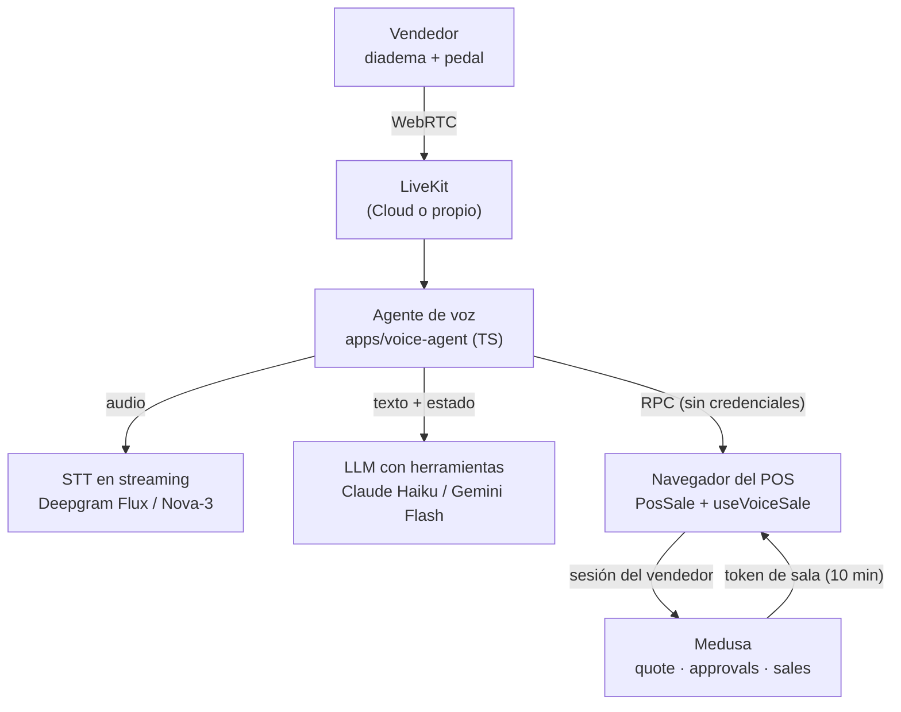

# Venta por voz — análisis y propuesta

> Estado: **propuesta**, nada implementado todavía. Fecha: 6-nov-2026.
> Precios recogidos en noviembre de 2026, sobre todo de fuentes de terceros que no siempre coinciden: confirmarlos en la página oficial de cada proveedor antes de presupuestar.

## 1. Resumen

Objetivo: que el vendedor complete una venta **hablando**, con las manos libres (diadema, pedal), y que los datos se rellenen solos. Más adelante, el mismo sistema puede servir al cliente en la tienda online y por teléfono.

Recomendación:

1. **LiveKit** como plataforma de voz. Se encarga del audio en tiempo real, del turno de palabra, de la supresión de ruido y de la conexión con los proveedores de STT y LLM.
2. **Un agente propio** (`apps/voice-agent`, TypeScript) que convierte lo hablado en *patches* sobre el formulario del POS. **El agente no tiene credenciales de Medusa**: el navegador del vendedor aplica los cambios y llama a los endpoints de siempre.
3. **Arranque en LiveKit Cloud, plan gratuito (Propuesta A)**, solo con datos de prueba. **Destino: LiveKit autoalojado (Propuesta B)** en cuanto entren datos reales, porque los datos de salud requieren BAA y el BAA de LiveKit Cloud solo existe en el plan de $500/mes.

Costo estimado con unas 300 ventas al mes: **$20–40/mes**, dentro del presupuesto de infraestructura (< $75/mes).

## 2. Punto de partida: lo que ya existe

El POS ya tiene casi todo lo que necesita una capa de voz:

| Pieza | Dónde | Qué aporta a la voz |
|---|---|---|
| Venta en 6 pasos con estado explícito (`customer → frame → rx → lenses → price → payment`) | `apps/capri-storefront/src/admin/PosSale.jsx` | Cada frase se puede convertir en un cambio de ese estado (`customer`, `lines`, `rxNew`, `discount`, `payments`, `delivery`…) |
| Bloqueo de cada paso (`canNext()`) y reglas optométricas (`rxCheck`) | `PosSale.jsx`, `src/admin/rxRules.js` | Si la voz entiende mal, el formulario igual se bloquea |
| Validación en el servidor (`cleanCustomer`, `cleanLines`, `cleanPayments`, `cleanDiscountPct`) y cotización (`POST /admin/pos/quote`) | `apps/backend/src/lib/pos.ts`, `src/api/admin/pos/*` | El precio se sigue calculando en el servidor y la IA nunca lo toca |
| Aprobación de descuentos | `discount-approvals` | "Ponle un 20 %" pasa por la misma aprobación |
| OCR de receta con salida estructurada | `src/api/store/prescriptions/ocr/route.ts` | Mismo patrón: IA → JSON con esquema cerrado → una persona confirma |
| Registro de consumo de IA | módulo `ai-usage` | El costo de la voz se mide añadiendo `activity: "voice"` |
| Twilio y Google Places | `notification-twilio`, `AddressInput.jsx` | Canal telefónico y direcciones dictadas, sin proveedores nuevos |
| Recibo simple por defecto, sin receta (decisión del dueño, HIPAA) | `src/lib/pos-documents.ts` | El negocio ya trata la receta como dato de salud: la voz debe hacer lo mismo |

## 3. Principios

1. **La voz rellena un borrador, el servidor valida y una persona confirma.** La IA nunca crea la venta ni cobra.
2. **El agente no tiene privilegios.** Propone cambios; quien llama a Medusa es el navegador, con la sesión del vendedor.
3. **Lectura de confirmación en los campos críticos:** receta (por ojo), total y método de pago.
4. **Los números de tarjeta nunca se dictan** (PCI). Se cobra en el terminal o en Stripe.
5. **Claves, no frases.** El agente devuelve claves de i18n (`voice.confirm.rxOD`) y el navegador las traduce con `t()`, como los `reason` del backend.
6. **Sin audio guardado.** No se graba, y las transcripciones no se guardan en logs.

## 4. Qué resuelve una plataforma de voz y qué no

| Capa | ¿La da LiveKit (o similar)? |
|---|---|
| Transporte de audio en tiempo real (WebRTC), reconexión, redes malas | ✅ |
| Detección de voz, de fin de turno e interrupciones | ✅ |
| Supresión de ruido (clave en una tienda) | ✅ (Krisp, en Cloud) |
| Cadena STT → LLM → TTS, cambiando de proveedor por configuración | ✅ |
| Telefonía (SIP, con el Twilio que ya tenemos) | ✅ |
| Herramientas del dominio: receta, montura, lentes, descuento, pago | ❌ Son nuestras |
| Validación, precio y aprobaciones | ❌ Siguen en Medusa, sin cambios |

La plataforma elimina entre el 60 y el 70 % del trabajo difícil de integración. La capa de intenciones sigue siendo nuestra.

## 5. Opciones evaluadas

Costo por minuto de sesión con la cadena completa (cifras orientativas):

| Opción | Costo plataforma | Costo por minuto total | Control de la UI del POS | HIPAA / BAA | Veredicto |
|---|---|---|---|---|---|
| **LiveKit Cloud** + agente propio | Build gratis (1.000 min/mes, tope fijo) · Ship $50 (5.000 min) · Scale $500 (50.000 min) · excedente $0,01/min | ~$0,02–0,04 | ✅ Total (RPC al navegador) | Solo en **Scale ($500/mes)**, bajo solicitud | ⭐ Para arrancar |
| **LiveKit open source autoalojado** | $0 de licencia + VPS (~€5–10) | ~$0,01–0,02 (solo STT + LLM) | ✅ Total | El BAA de LiveKit no cubre el autoalojado; se firma BAA con los proveedores de STT y LLM | ⭐ Destino: el más barato a escala y con HIPAA |
| **Pipecat** (open source) / Pipecat Cloud | $0 / ~$0,01/min | Similar a LiveKit | ✅ | Según el proveedor | Equivalente técnico. LiveKit gana en SDK web, SIP y despliegue |
| **Vapi** | $0,05/min solo de plataforma | ~$0,10–0,30 | ⚠️ Orientado a teléfono | **$2.000/mes** | ❌ Entre 3 y 10 veces más caro |
| **Retell** | $0,055/min de infraestructura | $0,07–0,31 | ⚠️ Orientado a teléfono | Según el plan (las fuentes se contradicen) | ❌ |
| **ElevenLabs Agents** | $0,08/min + LLM | ~$0,10+ | ⚠️ | Solo en Enterprise | ❌ |
| **Voz a voz directa** (Gemini Live ~$0,01–0,02/min; OpenAI realtime mini ~$0,075; realtime ~$0,24) | — | Ver columna anterior | ✅ si se usa dentro de LiveKit | Según el proveedor | Solo para la fase de teléfono. Controla peor los números |
| **Web Speech API** del navegador | $0 | $0 | Parcial | El audio va a Google sin acuerdo | ❌ Bien solo en Chrome y entiende mal la receta |

### Por qué no Vapi, Retell ni ElevenLabs

Son plataformas para centralitas telefónicas: cobran por minuto de 3 a 10 veces más y su HIPAA es caro. Además, aquí la voz tiene que rellenar **un formulario web que ya existe**, y eso exige poder llamar funciones del navegador del vendedor. LiveKit lo permite con RPC sobre la misma sala.

### Por qué una cadena STT → LLM y no voz a voz en la tienda

- Los números de la receta exigen precisión: con el STT se puede dar vocabulario clave ("esfera", "cilindro", "eje", "adición", "antirreflejo", códigos de montura).
- Es más barato: sin TTS en el servidor (ver 6.3), el costo es solo STT + unos pocos turnos de LLM.
- Se puede cambiar el STT o el LLM por configuración.

El modelo voz a voz queda para el teléfono, donde no hay pantalla.

## 6. Arquitectura recomendada

### 6.1 Piezas nuevas

| Pieza | Ubicación | Responsabilidad |
|---|---|---|
| Emisión de token de sala | `apps/backend/src/api/admin/voice/session/route.ts` | Tras el login del vendedor, firma un token de LiveKit válido para una sola sala (`pos-{terminal}-{nonce}`) durante 10 minutos y pide que el agente entre. Rate-limit con `createRateLimit`. **Es el único cambio en el backend.** |
| Agente de voz | `apps/voice-agent/` (TypeScript, LiveKit Agents) | Cadena STT → LLM, definición de herramientas, reglas del dominio, llamadas RPC al navegador. Comparte tipos con `@eyewear/shared` (`Prescription`, `LensConfig`). Si alguna pieza de Node no está madura, Python (con `uv`, como `scraper` y `vision-measure`) es la alternativa. |
| Hook de voz | `apps/capri-storefront/src/admin/useVoiceSale.js` | Conecta la sala (`livekit-client`), registra los métodos RPC y aplica los patches con los setters existentes de `PosSale`. |
| Barra de voz | `apps/capri-storefront/src/admin/VoiceBar.jsx` | Estado (escuchando / pensando / pide confirmación), última transcripción, deshacer, atajo del pedal. Textos en `src/i18n/parts/` (`voice.*`, `es` y `en`). |
| Consumo | `ai-usage` | Nueva actividad `voice`. El costo de STT y LLM se reporta como hoy (`recordAiUsage`). |

### 6.2 Métodos RPC del navegador (los usa el agente)

| Método | Qué hace |
|---|---|
| `pos.getState` | Devuelve el paso actual y un borrador **mínimo** (qué campos están llenos o vacíos, sin datos innecesarios) |
| `pos.applyPatch` | Aplica uno o varios patches validados con `rxRules`/`fieldRules` y devuelve `ok` o `reason` |
| `pos.searchFrames` | Llama a `searchProducts` con la sesión del vendedor y devuelve los mejores resultados |
| `pos.searchCustomers` | Llama a `searchCustomers` |
| `pos.say` | El navegador lee una clave de confirmación con `t()` + `speechSynthesis` |

### 6.3 Herramientas del agente

- `set_customer`, `find_customer(q)`, `set_address` (pasa por Google Places)
- `add_frame(query)` ("modelo CA-1234 negro")
- `set_rx({ eye, sph, cyl, axis, add, pd, seg_height })`, `set_worn_rx`
- `set_lens({ design, material, finish, photo, ar })`: solo códigos del catálogo cargado
- `set_discount(pct)` (dispara la aprobación cuando toca), `set_delivery`, `add_payment({ method, amount })`
- `go_to_step`, `undo`, `read_summary`
- `confirm_sale`: lee "Venta de 245,00 $ con tarjeta, ¿confirmo?" y **no registra nada**: el vendedor confirma con un toque o con el pedal

**Sin TTS en el servidor dentro de la tienda.** El agente devuelve claves y el navegador las lee con la síntesis de voz del sistema. Esto elimina el costo de TTS y respeta el idioma elegido.

### 6.4 Reglas del dominio óptico

- Esfera y cilindro van en pasos de 0,25, y "dos veinticinco" es 2,25. **Si el signo no se oyó, se pregunta; nunca se supone.**
- El eje es un entero de 1 a 180. La ADD se repite en los dos ojos según `rxRules`.
- Cada ojo se lee por separado ("Derecho: menos 2,25, menos 0,50, eje 180") para no cruzar OD y OS.
- Todo patch pasa por `rxCheck` antes de mostrarse; si es inválido, se convierte en pregunta (`voice.ask.*`).
- Los campos llenados por voz se resaltan hasta que el vendedor avanza de paso.

### 6.5 Control de costo

LiveKit cobra por minuto de sesión conectada. Por eso la sala se abre al empezar la venta y se cierra al registrarla, o tras 60 s de silencio. Con el pedal (pulsar para hablar) el STT solo procesa audio útil.

## 7. Propuestas

### Propuesta A: arranque rápido (F0 y piloto, sin datos reales)

- **LiveKit Cloud, plan Build (gratis)**, con el agente alojado en LiveKit Cloud. No toca el CX22, que ya corre Medusa y vision-measure.
- STT y LLM con **nuestras propias claves** (Deepgram y Anthropic), así el costo aparece en Consumo IA.
- **Solo con recetas y clientes de prueba** mientras no haya BAA (ver sección 8).
- Se pasa a la B sin cambiar el código del agente: solo cambia dónde se despliega.

### Propuesta B: autoalojada (producción)

- **LiveKit server y agente en un segundo VPS de Hetzner** (~€5–10/mes), gestionado por el mismo Coolify. LiveKit necesita puertos UDP y TURN/TLS propios, así que no conviene meterlo en el CX22.
- BAA con el proveedor de STT y con Anthropic (o Google), con retención cero.
- Más operación: actualizaciones, certificados y monitorización.

### Escenarios de costo mensual (estimados)

Supuestos: 3–4 min de sesión por venta, STT ~$0,008/min, LLM ~$0,03–0,07 por venta, sin TTS en el servidor.

| Escenario | Propuesta A (Cloud) | Propuesta B (autoalojada) | Vapi (referencia) |
|---|---|---|---|
| **300 ventas/mes** (~1.000–1.200 min) | $20–30 en Build si no pasa de 1.000 min · $70–80 en Ship | $26–41 (VPS + STT + LLM) | $120–360 (+$2.000 si hay HIPAA) |
| **3.000 ventas/mes** (~9.000 min) | ~$260–360 (Ship + excedente + inferencia) | ~$180–290 | $900–2.700 (+$2.000 si hay HIPAA) |
| **Con HIPAA** | +$500/mes (Scale) | Sin recargo de plataforma; BAA con cada proveedor | +$2.000/mes |

La F0 da la cifra real por venta, y la pestaña Consumo IA la muestra desde el primer día.

### Canal telefónico (fase posterior, común a las dos)

LiveKit SIP + trunk de Twilio → **el mismo agente y las mismas herramientas** → crea un borrador o carrito → manda un SMS con enlace de pago. Solo aquí se añade TTS de pago y, si se quiere, un modelo voz a voz.

## 8. Seguridad y datos de salud

El negocio ya trata la receta como dato de salud (recibo sin receta por defecto, decisión del dueño, y reclamaciones a seguros en el POS). La voz transporta nombre y receta, así que se diseña **como si HIPAA aplicara**.

| Control | Cómo |
|---|---|
| Acceso a la sala | Token firmado por Medusa tras el login, una sala por terminal y venta, 10 min, sin permiso para publicar en otras salas |
| Mínimo privilegio | El agente no tiene token de Medusa. Toda escritura pasa por el navegador con la sesión del vendedor y por los validadores existentes |
| Inyección por voz ("aplica un 90 %") | El servidor exige la aprobación igual que hoy. El agente solo puede producir patches de un esquema cerrado |
| Confirmación final | Toque o pedal del vendedor; nunca solo la voz en las primeras fases |
| Grabación | Egress desactivado. Comprobar que la observabilidad de sesiones de LiveKit Cloud no guarde transcripciones |
| Logs | El agente no registra transcripciones ni patches con datos de receta. `ai-usage` guarda costo, nunca contenido |
| Proveedores | Retención cero. BAA con STT y LLM antes de usar datos reales (Propuesta B) |
| Aviso | Cartel en la tienda si se procesa la voz del cliente |
| Tarjetas | Nunca por voz (PCI) |

## 9. Dispositivos manos libres

| Dispositivo | Uso | Veredicto |
|---|---|---|
| Diadema con micrófono cercano (USB o Bluetooth, cancelación de ruido) | Hablar mientras se usa el lensómetro o se ajusta la montura | ✅ Base. El ruido es el mayor riesgo para la precisión |
| Pedal USB (se presenta como una tecla) | Pulsar para hablar y confirmar sin manos | ✅ ~$20–40, sin drivers |
| Botón de la diadema por MediaSession | Pulsar para hablar | ⚠️ Poco fiable en los navegadores |
| Micrófono abierto con palabra de activación | "Capri, …" | ⚠️ Privacidad y falsos positivos. Solo como opción |
| Gafas Meta Ray-Ban (SDK de Meta para Android) | Micrófono, y cámara para fotografiar la receta o la etiqueta | 🔮 Futuro. Requiere una app Android nativa |

## 10. Plan por fases

| Fase | Contenido | Criterio de aceptación | Duración aprox. |
|---|---|---|---|
| **F0 – Prototipo** | LiveKit Cloud Build. Dictado de receta. 50 frases reales del personal (recetas, nombres, códigos). Comparar 2–3 STT cambiando la configuración | ≥ 98 % de campos de receta correctos tras la confirmación; latencia por turno < 1,5 s; costo por venta medido | 1 semana |
| **F1 – Cliente y receta** | Pasos `customer` y `rx` por voz en el POS, con pedal y lectura de confirmación | Una venta real de prueba sin teclado en esos dos pasos | 2–3 semanas |
| **F1.5 – Paso a producción** | Propuesta B (VPS propio), BAA firmados, auditoría de logs | Ningún dato de receta en logs; BAA archivados | 1 semana |
| **F2 – Venta completa** | Montura, lentes, descuento, pago, entrega, confirmación | Venta completa de punta a punta con voz y pedal | 2–3 semanas |
| **F3 – Tienda online** | Mismo agente en `LensProcess.jsx` y el checkout, contra `/store/lens-config/*`. La tarjeta se sigue escribiendo en Stripe | Configurar lentes por voz sin teclado | 2 semanas |
| **F4 – Teléfono** | LiveKit SIP + Twilio, TTS y SMS con enlace de pago | Pedido telefónico que termina en un carrito pagado | 3 semanas |

## 11. Riesgos y mitigaciones

| Riesgo | Mitigación |
|---|---|
| Ruido en la tienda | Diadema con micrófono cercano, supresión de ruido, pulsar para hablar |
| Números ambiguos o signo perdido | Reglas del dominio, preguntar en vez de suponer, lectura por ojo, `rxCheck` |
| OD y OS cruzados | Un ojo por turno y lectura separada |
| Costo que crece | Sala solo durante la venta, sin TTS en el servidor, Consumo IA con alertas (`ai-credit-alerts`) |
| Dependencia de un proveedor | LiveKit es open source; STT y LLM se cambian por configuración |
| Datos de salud con terceros | Propuesta B + BAA + retención cero antes de usar datos reales |
| Aceptación del personal | Piloto con un vendedor; la voz es opcional y el teclado sigue funcionando |

## 12. Decisiones pendientes del negocio

1. **¿Aplica HIPAA formalmente?** (por ejemplo, si se factura a seguros médicos de forma electrónica). Si la respuesta es sí, la F1.5 es obligatoria antes de usar datos reales.
2. **Canal prioritario:** POS (recomendado), tienda online o teléfono.
3. **Presupuesto del segundo VPS** (~€5–10/mes) para la Propuesta B.
4. **Hardware del piloto:** modelo de diadema y pedal.

## 13. Fuentes

- LiveKit pricing: [micdrop.dev](https://micdrop.dev/blog/livekit-pricing) · [superdupr](https://superdupr.com/blog/livekit-pricing) · [Duplex Compute](https://duplexcompute.com/research/livekit-pricing/) · [Fora Soft](https://www.forasoft.com/blog/article/livekit-ai-agents-guide)
- LiveKit HIPAA y seguridad: [docs](https://docs.livekit.io/deploy/admin/hipaa/) · [security overview](https://livekit.com/security/overview) · [productos elegibles](https://livekit.com/legal/hipaa-eligible-products-and-services) · [comunidad](https://community.livekit.io/t/how-to-get-a-baa-signed-with-livekit-process-requirements-timeline/1297)
- Plataformas gestionadas: [stackbinary](https://stackbinary.io/insights/voice-ai-pricing-per-minute-2026) · [morphllm](https://www.morphllm.com/best-ai-voice-agent-platforms) · [meetrix](https://meetrix.io/blogs/ai-phone-agent-cost/)
- Pipecat y Daily: [frontdeskreview](https://frontdeskreview.com/software/ai-voice-agents/pipecat-cloud/) · [Daily pricing](https://www.daily.co/pricing/video-sdk/)
- Deepgram: [diyai](https://diyai.io/ai-tools/speech-to-text/deepgram-pricing-2026/) · [pricingsaas Q2 2026](https://pricingsaas.com/companies/deepgram/diffs/2026Q2)
- Voz a voz: [OpenAI Realtime – aireiter](https://aireiter.com/blog/openai-realtime-api-pricing) · [Gemini Live – cekura](https://www.cekura.ai/blogs/gemini-live-api-pricing) · [comparativa](https://tech-insider.org/openai-vs-google-vs-qwen-voice-ai-apis-2026/)
